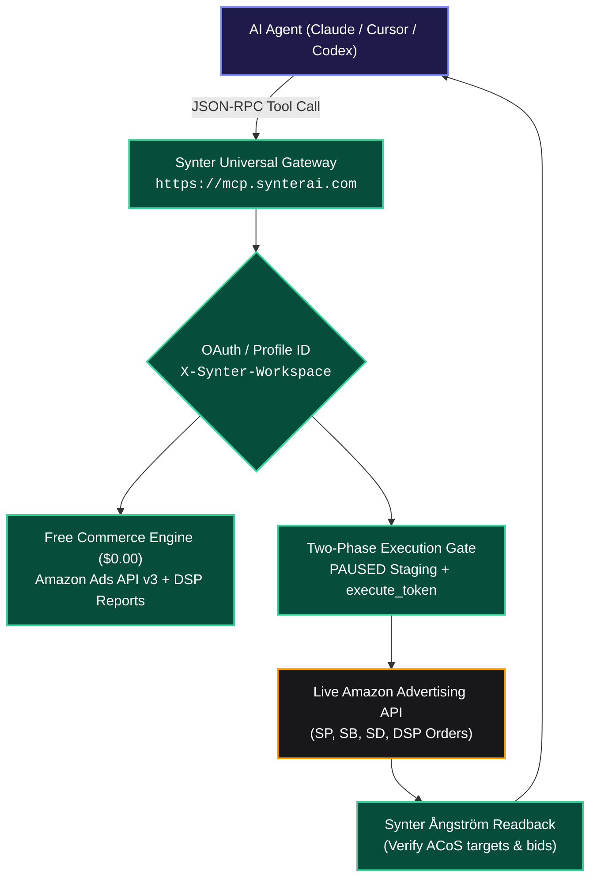

# Amazon Ads & Amazon DSP MCP Server — Synter Universal Ads Gateway

[](https://modelcontextprotocol.io/)
[](https://synterai.com/mcp/amazon)
[-brightgreen.svg)](https://synterai.com/pricing)
[](https://synterai.com/pricing)

> **Connect Claude Desktop, Cursor, Codex, and AI agents directly to Amazon Sponsored Ads and Amazon DSP through the official Synter Universal MCP gateway.**  
> Audit ACoS and TACoS across Sponsored Products, Sponsored Brands, and Sponsored Display for $0.00, manage negative keywords, and adjust programmatic DSP orders safely.

---

## ⚡ Quick Specs & Capabilities

- **Gateway Endpoint**: `https://mcp.synterai.com` (transport: Streamlined HTTP / SSE)
- **Supported Amazon Products**:
  - **Sponsored Products**: Keyword and product targeting (ASIN) with dynamic bidding.
  - **Sponsored Brands**: Headline search and video ads linked to Amazon Storefront.
  - **Sponsored Display**: Audience and contextual targeting on and off Amazon.
  - **Amazon DSP**: Programmatic video, display, and audio across Twitch, Prime Video, and Amazon publishers.
- **Negative Keyword Support**: NEGATIVE_EXACT and NEGATIVE_PHRASE (Amazon Sponsored Products SDK standard).
- **Pricing & Fee**: **100% Free to Read** ($0/mo, 0 credits for performance metrics, ACoS tracking, and search term reports). Live writes start at $20/mo on SOLO (includes $20.00 claimable credits). **0% ad spend fee** (zero platform markup).



---

## 🛠️ Complete Amazon Ads MCP Tools Reference (14 Tools)

### 1. Free Reporting & Commerce Diagnostic Tools ($0.00 / 0 Credits)

| Tool Name | Parameters | Description |
| :--- | :--- | :--- |
| `pull_amazon_performance` | `start_date`, `end_date`, `profile_id` | Pull spend, impressions, clicks, attributed sales (14-day), units sold, and ACoS. |
| `get_amazon_search_terms` | `days: 14`, `campaign_type` | Identify customer search queries driving high spend with zero orders. |
| `list_amazon_campaigns` | `campaign_type`, `status` | List Sponsored Products, Brands, and Display campaigns with active daily budgets. |
| `list_amazon_ad_groups` | `campaign_id` | Enumerate ad groups, default bids, and targeting configurations. |
| `get_amazon_dsp_order_performance` | `advertiser_id`, `time_range` | Query Amazon DSP programmatic order and line-item delivery metrics. |
| `audit_amazon_account_hygiene` | `profile_id` | Audit keyword duplication across ad groups and missing negative phrase/exact terms. |

### 2. Campaign Planning & Execution Tools (SOLO $20/mo)

| Tool Name | Parameters | Description |
| :--- | :--- | :--- |
| `create_campaign_plan` | `brief_json`, `plan_key` | Stage complete Sponsored Products or Brands campaign hierarchy as PAUSED. |
| `execute_campaign_plan` | `plan_id`, `execute_token` | Deploy staged Amazon Ads campaigns after explicit operator sign-off. |
| `update_campaign_budget` | `platform: "amazon"`, `campaign_id`, `daily_budget` | Update Amazon campaign daily budget safely. |
| `update_amazon_keyword_bid` | `keyword_id`, `bid` | Adjust cost-per-click bids based on target ACoS efficiency. |
| `add_amazon_negative_keywords` | `campaign_id`, `negatives`, `match_type` | Add `NEGATIVE_EXACT` or `NEGATIVE_PHRASE` keywords to prevent bleed. |
| `pause_campaign` | `platform: "amazon"`, `campaign_id` | Instantly stop spend on any Amazon campaign. |
| `get_ad_readback` | `platform: "amazon"`, `entity_id` | Verify bid propagation, moderation status, and live servability on Amazon. |

---

## 💻 60-Second Client Configuration

### Claude Desktop
Add to `claude_desktop_config.json`:
```json
{
  "mcpServers": {
    "synter-ads": {
      "url": "https://mcp.synterai.com"
    }
  }
}
```

### Cursor
Add to `.cursor/mcp.json`:
```json
{
  "mcpServers": {
    "synter-ads": {
      "url": "https://mcp.synterai.com"
    }
  }
}
```

---

## 🎯 Battle-Tested Agent Prompts

### 1. Amazon ACoS Efficiency & Wasted Spend Hunter
```text
Pull our Amazon Sponsored Products search terms report for the past 14 days.
Identify all customer search queries where spend exceeds $30 and 14-day orders = 0.
Draft a recommendation to add them as NEGATIVE_EXACT keywords to protect daily margin.
```

### 2. Sponsored Products Bid Adjustment based on Target ACoS
```text
Inspect our active Sponsored Products keyword targets.
For keywords where ACoS is below our target of 25%, calculate a 15% bid increase.
For keywords where ACoS exceeds 40%, calculate a bid decrease to reach target efficiency.
```

---

## 📄 License & Canonical Links
- Documentation: [https://synterai.com/mcp/amazon](https://synterai.com/mcp/amazon)
- Pricing: [https://synterai.com/pricing](https://synterai.com/pricing)
- MIT License © [Synter](https://synterai.com)
