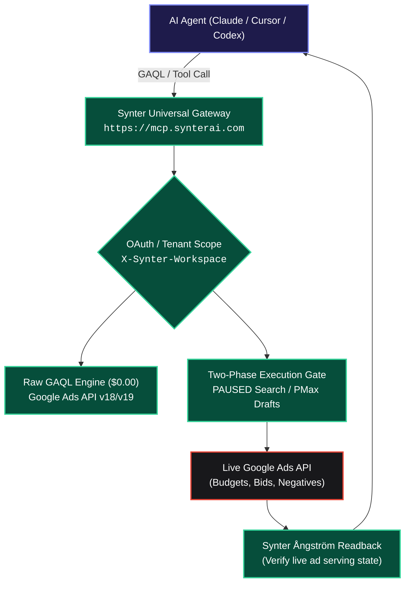

# Google Ads MCP Server — Synter Universal Ads Gateway

[](https://modelcontextprotocol.io/)
[](https://synterai.com/mcp/google)
[-brightgreen.svg)](https://synterai.com/pricing)
[](https://synterai.com/pricing)

> **Connect Claude Desktop, Cursor, Codex, and AI agents directly to Google Ads through the official Synter Universal MCP gateway.**  
> Execute raw Google Ads Query Language (GAQL) queries for $0.00, hunt wasted search spend, audit Performance Max asset groups, and deploy high-converting Search campaigns with Smart Bidding guardrails.

---

## ⚡ Quick Specs & Capabilities

- **Gateway Endpoint**: `https://mcp.synterai.com` (transport: Streamlined HTTP / SSE)
- **Supported Campaign Types**: Google Search, Performance Max (PMax), Demand Gen, YouTube Video, Display, App Campaigns.
- **Query Support**: Direct GAQL execution against `search_term_view`, `campaign`, `ad_group`, `keyword_view`, and `customer`.
- **Bidding Strategies**: MAXIMIZE_CONVERSIONS (with Target CPA), MAXIMIZE_CONVERSION_VALUE (with Target ROAS).
- **Pricing & Fee**: **100% Free to Read** ($0/mo, 0 credits for GAQL queries, search audits, and metrics). Live writes start at $20/mo on SOLO (includes $20.00 claimable credits). **0% ad spend fee** (zero platform markup).



---

## 🛠️ Complete Google Ads MCP Tools Reference (16 Tools)

### 1. Free Reporting & GAQL Diagnostic Tools ($0.00 / 0 Credits)

| Tool Name | Parameters | Description |
| :--- | :--- | :--- |
| `run_gaql_query` | `query`, `customer_id` | Execute arbitrary Google Ads Query Language (GAQL) queries with structured JSON responses. |
| `pull_google_performance` | `start_date`, `end_date`, `customer_id` | Pull spend, impressions, clicks, conversions, conversion value, and CPA. |
| `get_search_terms_report` | `days: 14`, `min_spend: 30` | Identify non-converting search queries bleeding budget across Search and PMax. |
| `list_google_campaigns` | `status`, `customer_id` | List Search, PMax, and Demand Gen campaigns with bidding strategy and budget status. |
| `list_negative_keywords` | `campaign_id` | Inspect active campaign-level and account-level negative keyword lists. |
| `ga4_get_report` | `property_id`, `dimensions`, `metrics` | Pull native GA4 acquisition reports to cross-verify Google Ads attribution. |
| `verify_pixel_ownership` | `url`, `platform: "google"` | Verify Google tag (gtag.js / AW-) ownership and conversion event configuration. |

### 2. Campaign Planning & Execution Tools (SOLO $20/mo)

| Tool Name | Parameters | Description |
| :--- | :--- | :--- |
| `research_campaign_opportunity` | `seed_keywords`, `geo_target` | Retrieve keyword search volumes, top-of-page CPCs, and competitor domain presence. |
| `create_campaign_plan` | `brief_json`, `plan_key` | Stage complete Search / PMax campaign with RSAs, match types, and negative lists as PAUSED. |
| `execute_campaign_plan` | `plan_id`, `execute_token` | Deploy the staged campaign live to Google Ads after operator verification. |
| `update_campaign_budget` | `platform: "google"`, `campaign_id`, `daily_budget` | Update daily spend budget safely within account limits. |
| `pause_campaign` | `platform: "google"`, `campaign_id` | Instantly pause any Google Ads campaign. |
| `add_negative_keywords` | `campaign_id`, `negatives`, `match_type` | Add EXACT or PHRASE negative keywords to seal wasted spend leaks. |
| `create_ad_copy` | `platform: "google"`, `product`, `headlines_count: 5` | Generate compliant Responsive Search Ad (RSA) headlines (≤30 chars) and descriptions (≤90 chars). |
| `get_ad_readback` | `platform: "google"`, `entity_id` | Confirm live delivery status, ad strength rating, and budget approval in Google Ads. |

---

## 💻 60-Second Client Configuration

### Claude Desktop
Add to `claude_desktop_config.json`:
```json
{
  "mcpServers": {
    "synter-ads": {
      "url": "https://mcp.synterai.com"
    }
  }
}
```

### Cursor
Add to `.cursor/mcp.json`:
```json
{
  "mcpServers": {
    "synter-ads": {
      "url": "https://mcp.synterai.com"
    }
  }
}
```

---

## 🎯 Battle-Tested Agent Prompts

### 1. GAQL Search Terms Wasted Spend Audit
```text
Run a GAQL query on my Google Ads account to extract search terms from the last 14 days where cost > $50 and conversions = 0.
Show search term, impressions, clicks, cost, and campaign name.
Categorize the search terms into negative keyword candidates (EXACT match).
```

### 2. Google Search Campaign Standard Staging
```text
Stage a Google Ads Search campaign for 'Enterprise SOC2 Compliance Automation'.
Target Google Search only (disable Search Partners and Display Network).
Set bidding to MAXIMIZE_CONVERSIONS with a Target CPA of $85.
Include 5 punchy RSA headlines with intentional disqualification ('For Engineering Teams', 'SOC2 Certified in 14 Days').
```

### 3. GA4 vs Google Ads Attribution Cross-Check
```text
Pull Google Ads reported conversions for the past 30 days and compare with GA4 purchase events from sessionMedium = 'cpc'.
Calculate the discrepancy rate and verify if gclid / wbraid parameters are arriving intact.
```

---

## 📄 License & Canonical Links
- Documentation: [https://synterai.com/mcp/google](https://synterai.com/mcp/google)
- Pricing: [https://synterai.com/pricing](https://synterai.com/pricing)
- MIT License © [Synter](https://synterai.com)
