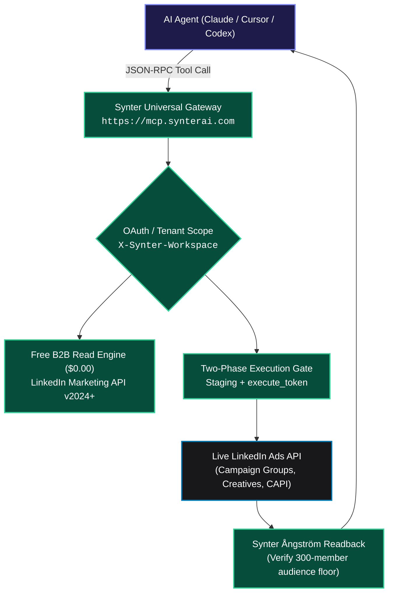

# LinkedIn Ads MCP Server — Synter Universal Ads Gateway

[](https://modelcontextprotocol.io/)
[](https://synterai.com/mcp/linkedin)
[-brightgreen.svg)](https://synterai.com/pricing)
[](https://synterai.com/pricing)

> **Connect Claude Desktop, Cursor, Codex, and AI agents directly to LinkedIn Ads through the official Synter Universal MCP gateway.**  
> Audit high-cost B2B campaign spend for $0.00, inspect matched audiences, synchronize company account lists (ABM), and launch Sponsored Content with verified Conversions API (CAPI) rules.

---

## ⚡ Quick Specs & Capabilities

- **Gateway Endpoint**: `https://mcp.synterai.com` (transport: Streamlined HTTP / SSE)
- **Supported Formats**: Sponsored Content (Single Image, Carousel, Video, Document Post), Lead Gen Forms, Message Ads.
- **B2B Targeting**: Job Titles, Job Seniorities, Company Names, Company Industries, Company Headcount, Matched Audiences.
- **Conversion Tracking**: LinkedIn Insight Tag & LinkedIn Conversions API (CAPI) with full user signal matching.
- **Pricing & Fee**: **100% Free to Read** ($0/mo, 0 credits for B2B performance pulls and audience audits). Live writes start at $20/mo on SOLO (includes $20.00 claimable credits). **0% ad spend fee** (zero platform markup).



---

## 🛠️ Complete LinkedIn Ads MCP Tools Reference (14 Tools)

### 1. Free Reporting & B2B Audit Tools ($0.00 / 0 Credits)

| Tool Name | Parameters | Description |
| :--- | :--- | :--- |
| `pull_linkedin_performance` | `date_preset`, `time_range`, `account_id` | Pull spend, impressions, clicks, CPC, CPM, leads, and cost per lead (CPL). |
| `list_linkedin_campaigns` | `status`, `campaign_group_id` | List active campaigns, daily/total budgets, and targeting summaries. |
| `list_linkedin_audiences` | `account_id` | Inspect Matched Audiences, contact lists, and company list sync statuses. |
| `get_linkedin_conversion_rules` | `account_id` | Audit conversion definitions, verifying verified vs unverified tracking status. |
| `verify_pixel_ownership` | `url`, `platform: "linkedin"` | Confirm the landing page carries the valid LinkedIn Partner ID (Insight Tag). |
| `audit_account_structure` | `platform: "linkedin"` | Check for audience overlap and audiences below the mandatory 300-member floor. |

### 2. Campaign Planning & B2B Execution Tools (SOLO $20/mo)

| Tool Name | Parameters | Description |
| :--- | :--- | :--- |
| `create_campaign_plan` | `brief_json`, `plan_key` | Stage complete LinkedIn campaign groups, campaigns, and creatives as PAUSED. |
| `execute_campaign_plan` | `plan_id`, `execute_token` | Deploy staged B2B campaigns after operator review and approval. |
| `upload_audience` | `platform: "linkedin"`, `company_names`, `company_domains` | Sync target account lists (ABM) directly into LinkedIn Matched Audiences. |
| `update_campaign_budget` | `platform: "linkedin"`, `campaign_id`, `daily_budget` | Adjust daily or total spend limits across B2B campaigns. |
| `pause_campaign` | `platform: "linkedin"`, `campaign_id` | Instantly stop spending on campaigns exceeding CPL targets. |
| `create_ad_copy` | `platform: "linkedin"`, `product`, `tone: "executive"` | Generate B2B headlines (≤70 chars) and introductory text tailored to C-suite/decision-makers. |
| `create_image_asset` | `platform: "linkedin"`, `mode: "system-graphic"`, `headline` | Produce 1.91:1 high-contrast B2B creative with embedded technical typography. |
| `get_ad_readback` | `platform: "linkedin"`, `entity_id` | Verify creative approval state, serving eligibility, and live budget. |

---

## 💻 60-Second Client Configuration

### Claude Desktop
Add to `claude_desktop_config.json`:
```json
{
  "mcpServers": {
    "synter-ads": {
      "url": "https://mcp.synterai.com"
    }
  }
}
```

### Cursor
Add to `.cursor/mcp.json`:
```json
{
  "mcpServers": {
    "synter-ads": {
      "url": "https://mcp.synterai.com"
    }
  }
}
```

---

## 🎯 Battle-Tested Agent Prompts

### 1. LinkedIn B2B Cost Per Lead (CPL) Audit
```text
Pull our LinkedIn Ads performance for the last 30 days.
Group results by campaign group and calculate Cost Per Lead (CPL) and Lead Gen Form completion rate.
Flag any campaign where CPL is greater than $120.
```

### 2. ABM Target Account List (TAL) Sync
```text
Upload this list of 50 enterprise SaaS domains to our LinkedIn Matched Audiences under the name 'Q1 Tier 1 Accounts'.
Verify that the audience is staged cleanly and check if audience size meets the 300-member serving minimum.
```

### 3. Executive Sponsored Content Staging
```text
Stage a LinkedIn Single Image Sponsored Content campaign targeting Chief Technology Officers and VP of Engineering at companies with 200-5000 employees.
Set daily budget to $75. Generate high-contrast, text-led copy focusing on developer tool productivity gains.
```

---

## 📄 License & Canonical Links
- Documentation: [https://synterai.com/mcp/linkedin](https://synterai.com/mcp/linkedin)
- Pricing: [https://synterai.com/pricing](https://synterai.com/pricing)
- MIT License © [Synter](https://synterai.com)
