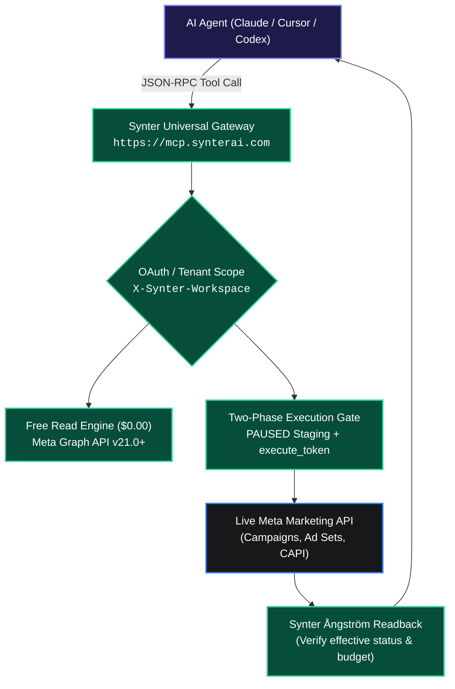

# Meta Ads MCP Server (Facebook & Instagram) — Synter Universal Ads Gateway

[](https://modelcontextprotocol.io/)
[-green.svg)](https://synterai.com/mcp/meta)
[-brightgreen.svg)](https://synterai.com/pricing)
[](https://synterai.com/pricing)

> **Connect Claude Desktop, Cursor, Codex, ChatGPT, and AI agents directly to Meta Ads (Facebook & Instagram) through the official Synter Universal MCP gateway.**  
> Pull campaign analytics for $0.00, audit Instagram Reels CPMs, verify Conversions API (CAPI) datasets, and execute approved ABO/CBO budget modifications deterministically.

---

## ⚡ Quick Specs & Capabilities

- **Gateway Endpoint**: `https://mcp.synterai.com` (transport: Streamlined HTTP / SSE)
- **Supported Placements**: Facebook Feed, Instagram Feed, Instagram Reels, Instagram Stories, Facebook Reels, Messenger, Audience Network.
- **Campaign Objectives**: OUTCOME_LEADS, OUTCOME_SALES, OUTCOME_TRAFFIC, OUTCOME_ENGAGEMENT, OUTCOME_AWARENESS.
- **Budget Modes**: Ad Set Budget Optimization (ABO) & Advantage+ Campaign Budget (CBO).
- **Pricing & Fee**: **100% Free to Read** ($0/mo, 0 credits for reports, insights, and tracking audits). Live writes start at $20/mo on SOLO (includes $20.00 claimable credits). **0% ad spend fee** (zero platform markup).



---

## 🛠️ Complete Meta Ads MCP Tools Reference (15 Tools)

### 1. Free Reporting & Diagnostic Tools ($0.00 / 0 Credits)

| Tool Name | Parameters | Description |
| :--- | :--- | :--- |
| `pull_meta_performance` | `date_preset`, `time_range`, `account_id` | Pull spend, impressions, clicks, CPC, CPM, purchases, leads, and ROAS. |
| `get_meta_placement_breakdown` | `time_range`, `breakdowns` | Breakdown metrics across Reels, Stories, and Feeds to isolate CPM spikes. |
| `get_meta_ad_insights` | `ad_id`, `date_preset` | Inspect creative-level metrics, video 3-second views, and hook retention rate. |
| `list_meta_campaigns` | `status`, `account_id` | Enumerate all campaigns, daily budgets, bidding strategies, and delivery statuses. |
| `list_meta_ad_sets` | `campaign_id`, `account_id` | Inspect targeting criteria, audience definitions, and ABO daily budgets. |
| `get_meta_pixel_status` | `dataset_id`, `account_id` | Verify Conversions API (CAPI) health, event deduplication, and active pixel events. |
| `verify_pixel_ownership` | `url`, `platform: "meta"` | Crawl landing page to verify Meta Pixel ID matches the connected ad account. |

### 2. Campaign Management & Two-Phase Execution Tools (SOLO $20/mo)

| Tool Name | Parameters | Description |
| :--- | :--- | :--- |
| `create_campaign_plan` | `brief_json`, `plan_key` | Stage complete ABO/CBO campaigns as `PAUSED` drafts and receive an `execute_token`. |
| `execute_campaign_plan` | `plan_id`, `execute_token` | Push the staged Meta campaign live following operator confirmation. |
| `update_campaign_budget` | `platform: "meta"`, `campaign_id`, `daily_budget` | Adjust CBO daily budget with automated $\le 20\%$ safety step limits. |
| `update_adset_budget` | `adset_id`, `daily_budget` | Adjust ABO ad set daily budget to scale winning concepts or trim losers. |
| `pause_meta_ad` | `ad_id` | Immediately pause fatigued ad creative with high frequency (>3.5). |
| `pause_campaign` | `platform: "meta"`, `campaign_id` | Instantly stop spending on an underperforming campaign. |
| `create_ad_copy` | `platform: "meta"`, `product`, `tone` | Generate high-converting primary text, headlines, and link descriptions. |
| `get_ad_readback` | `platform: "meta"`, `entity_id` | Query live Meta Graph API to confirm effective status and budget after changes. |

---

## 💻 60-Second Client Configuration

### Claude Desktop
Add to `claude_desktop_config.json`:
```json
{
  "mcpServers": {
    "synter-ads": {
      "url": "https://mcp.synterai.com"
    }
  }
}
```

### Cursor
Add to `.cursor/mcp.json`:
```json
{
  "mcpServers": {
    "synter-ads": {
      "url": "https://mcp.synterai.com"
    }
  }
}
```

### Headless Agents & n8n
```http
POST https://mcp.synterai.com
Authorization: Bearer <SYNTER_API_KEY>
X-Synter-Workspace: <WORKSPACE_ID>
X-Synter-Account: <META_ACT_ID>
```

---

## 🎯 Battle-Tested Agent Prompts

### 1. Instagram Reels CPM & Placement Audit
```text
Pull our Meta Ads performance for the last 14 days broken down by placement.
Compare CPM, CTR, and CPA across Instagram Reels, Instagram Stories, and Facebook Feed.
Flag any ad creatives where frequency has exceeded 3.0 or where Reels CPM is 50% above the account average.
```

### 2. Stacy Sizemore ABO Concept Evaluation
```text
Inspect our active Meta Ad Sets under the 'Concept Testing' ABO campaign.
Identify ad sets that have spent > 1.5x our target CPA ($45) with 0 purchases in the last 5 days.
Draft a recommendation to pause the losing ad sets and increase budget by 20% on the top-converting concept.
```

### 3. Conversions API (CAPI) & Pixel Verification
```text
Check the health of our Meta Conversions API dataset.
Verify that 'Purchase' and 'Lead' events are firing with proper event_id deduplication against client-side pixel events.
```

---

## 📄 License & Canonical Links
- Documentation: [https://synterai.com/mcp/meta](https://synterai.com/mcp/meta)
- Pricing: [https://synterai.com/pricing](https://synterai.com/pricing)
- MIT License © [Synter](https://synterai.com)
