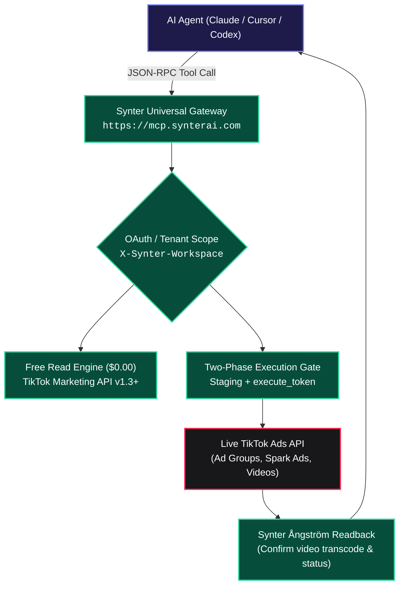

# TikTok Ads MCP Server — Synter Universal Ads Gateway

[](https://modelcontextprotocol.io/)
[](https://synterai.com/mcp/tiktok)
[-brightgreen.svg)](https://synterai.com/pricing)
[](https://synterai.com/pricing)

> **Connect Claude Desktop, Cursor, Codex, and AI agents directly to TikTok Ads through the official Synter Universal MCP gateway.**  
> Monitor video retention and hook rates for $0.00, manage Spark Ads and Creator authorizations, sync custom audiences, and deploy 9:16 vertical video campaigns.

---

## ⚡ Quick Specs & Capabilities

- **Gateway Endpoint**: `https://mcp.synterai.com` (transport: Streamlined HTTP / SSE)
- **Supported Formats**: In-Feed Video (9:16), Upgraded Smart+ Campaigns (`/smart_plus/*`), TikTok Search Ads (`is_search_campaign` + `search_keywords`), Spark Ads, Carousel Ads, Lead Generation Ads, TikTok Shop Ads.
- **Conversion Tracking**: TikTok Pixel & TikTok Events API (CAPI) with full event deduplication.
- **Audience & Targeting Discovery**: Customer File Audiences, Engagement Audiences, Lookalike Audiences, Search Keyword Recommendations, Carrier/Language/Interest Discovery.
- **Creative Library**: Video upload/search, Image upload/search, Commercial Music library search (`--asset-type music`), and Smart+ Material Overview Reports.
- **Pricing & Fee**: **100% Free to Read** ($0/mo, $0.00 usage for performance metrics and retention analysis). Live writes start at $20/mo on SOLO (includes $20.00 claimable credits). **0% ad spend fee** (zero platform markup).



---

## 🛠️ Complete TikTok Ads MCP Tools Reference (13 Tools)

### 1. Free Reporting & Video Analytics Tools ($0.00 / 0 Credits)

| Tool Name | Parameters | Description |
| :--- | :--- | :--- |
| `pull_tiktok_performance` | `start_date`, `end_date`, `advertiser_id` | Pull spend, impressions, clicks, video views, CTR, CPC, and conversion events. |
| `get_tiktok_video_insights` | `video_id`, `time_range` | Analyze video retention curves: 2-second hook rate, 6-second retention, and average watch time. |
| `list_tiktok_campaigns` | `status`, `advertiser_id` | Enumerate active campaigns, daily budgets, and optimization goals. |
| `list_tiktok_ad_groups` | `campaign_id` | Inspect targeting criteria, placement selections, and bid strategies. |
| `get_tiktok_pixel_status` | `pixel_id` | Audit TikTok Events API and client-side pixel firing health and deduplication. |
| `verify_pixel_ownership` | `url`, `platform: "tiktok"` | Verify the presence and correctness of the TikTok Pixel on the target URL. |

### 2. Campaign Planning & Execution Tools (SOLO $20/mo)

| Tool Name | Parameters | Description |
| :--- | :--- | :--- |
| `create_campaign_plan` | `brief_json`, `plan_key` | Stage complete TikTok campaigns and ad groups with 9:16 video creative as PAUSED. |
| `execute_campaign_plan` | `plan_id`, `execute_token` | Launch the staged TikTok campaign after explicit operator confirmation. |
| `create_video_ad` | `concept: "hook-demo-cta"`, `product`, `platform: "tiktok"` | Generate high-retention 9:16 vertical video assets with auto-burned captions. |
| `upload_audience` | `platform: "tiktok"`, `emails`, `audience_name` | Upload SHA-256 hashed customer lists to TikTok Custom Audiences. |
| `update_campaign_budget` | `platform: "tiktok"`, `campaign_id`, `daily_budget` | Modify daily spend budgets safely without breaking learning phase limits. |
| `pause_campaign` | `platform: "tiktok"`, `campaign_id` | Instantly stop spend on fatigue or low-converting campaigns. |
| `get_ad_readback` | `platform: "tiktok"`, `entity_id` | Verify video transcoding completion, ad approval, and active serving status. |

---

## 💻 60-Second Client Configuration

### Claude Desktop
Add to `claude_desktop_config.json`:
```json
{
  "mcpServers": {
    "synter-ads": {
      "url": "https://mcp.synterai.com"
    }
  }
}
```

### Cursor
Add to `.cursor/mcp.json`:
```json
{
  "mcpServers": {
    "synter-ads": {
      "url": "https://mcp.synterai.com"
    }
  }
}
```

---

## 🎯 Battle-Tested Agent Prompts

### 1. TikTok 2-Second Hook Rate Diagnostic
```text
Pull our TikTok Ads video performance for the last 7 days.
Calculate the 2-second hook rate (2-second views / impressions) for each active creative.
Flag any video ad where the hook rate is under 25% and suggest a new visual hook.
```

### 2. High-Intent Lead Generation Campaign Staging
```text
Stage a TikTok In-Feed Video campaign targeting United States users interested in Developer Tools and Cloud Infrastructure.
Set daily budget to $50 on an ABO structure.
Use the 'hook-demo-cta' video template and optimize for Complete Registration.
```

---

## 📄 License & Canonical Links
- Documentation: [https://synterai.com/mcp/tiktok](https://synterai.com/mcp/tiktok)
- Pricing: [https://synterai.com/pricing](https://synterai.com/pricing)
- MIT License © [Synter](https://synterai.com)
